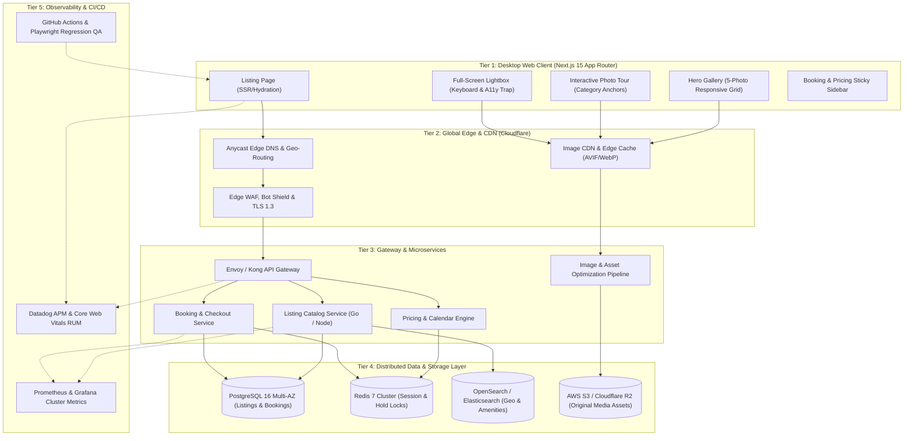

# Production-Scale Vacation Rental System Architecture

## Architecture Diagram (Mermaid)

## Architectural Highlights

### 1. High Availability & Concurrency
- **Zero-Downtime Blue/Green Deployments:** Managed via Kubernetes (EKS) and GitHub Actions.
- **Edge Anycast Routing:** Cloudflare Anycast routes global users to the nearest Point of Presence (PoP) with sub-10ms DNS resolution.
- **Microservices Isolation:** Failure in booking or third-party payment processing does not degrade listing catalog or media viewing.

### 2. High-Resolution Media Delivery
- **Responsive Image Negotiation:** Edge CDN dynamically negotiates AVIF and WebP based on client Accept headers.
- **Progressive Blur Placeholders:** Next.js `<Image />` component renders inline SVG blur data URLs for instant perceptual paint (LCP < 1.2s).
- **Immutable CDN Caching:** Processed image variants are cached with `Cache-Control: public, max-age=31536000, immutable`.

### 3. Real-Time Reservation Locks
- **Redis Redlock Pattern:** Dynamic night availability locks hold selected reservation dates for 15 minutes during checkout to eliminate double-booking race conditions.
- **Idempotency Keys:** Payment requests carry unique UUIDv4 idempotency keys preventing duplicate debits during network retries.

### 4. Accessibility & Core Web Vitals SLA
- **Largest Contentful Paint (LCP):** < 1.2s (Priority hero image loading).
- **Cumulative Layout Shift (CLS):** 0.000 (Explicit image aspect ratios and fixed container heights).
- **Interaction to Next Paint (INP):** < 50ms (Optimized React 19 synthetic event handling and zero heavy script blocking).
- **WCAG 2.1 AA Compliance:** Full keyboard trap in modals, ARIA dialog roles, live announcer counters, and focus restoration upon Escape.
